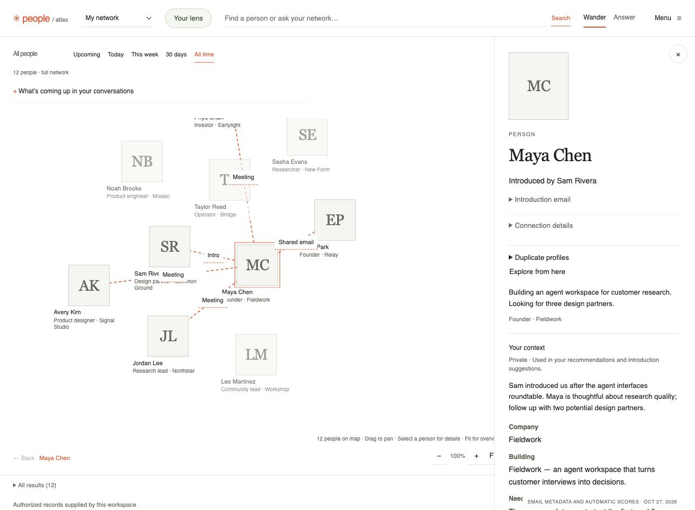
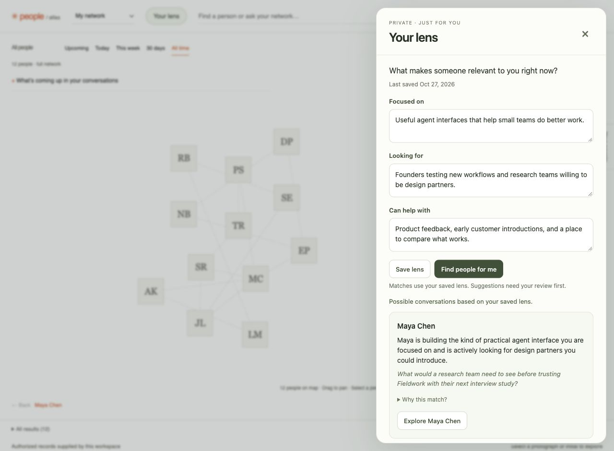
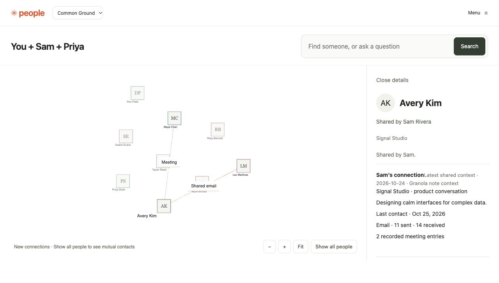
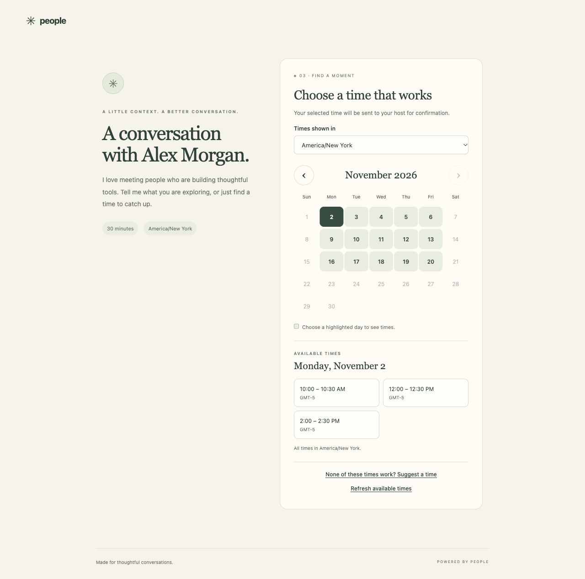
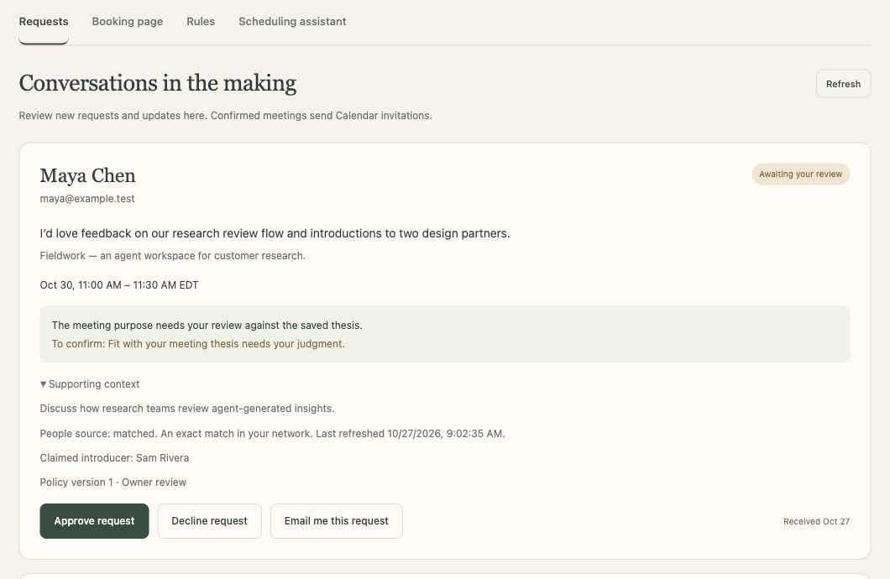

# People

**Your network, with context.**

Remember who someone is to you, find people relevant to what you’re working on, and turn useful connections into conversations. People brings together your email activity, meeting context, and the things you know about someone in an interactive relationship graph.

**[Open People →](https://people-graph.kayarjones901.workers.dev/)** · [Get started](#get-started) · [Connect your agent](#use-people-with-your-agent) · [Self-host](apps/people-graph/README.md#setup-once)



*Screenshots show the current web UI with fictional people and sample data. [Preview and capture instructions](docs/screenshots/README.md).*

People works as a **standalone web app**, through a **Rust CLI or MCP connection to your agent**, and as an optional **Obsidian plugin**. You don’t need Obsidian to use the web app. The repository name comes from its beginnings as Gmail CRM for Obsidian.

## A tour of the app

### Remember the person behind the contact

**“How do I know Maya, and what did we last talk about?”**

Open **My network**, search for someone, and select their node. Their profile brings together recent context, contact activity, and the evidence behind a connection. Where a supported introduction is found, it can name the person who introduced you. Links distinguish introductions, shared email threads, shared meetings, and inferred connections.

Add your own context when email alone misses the point: what they’re building, what they need, or something to follow up on. Saved private context stays with that person and can guide future suggestions.

The **People score** summarizes recorded activity and recency. It helps you understand the data you have; it isn’t a measure of personal closeness. A shared email thread is not automatically an introduction.

### Find people for what you’re working on

**“Who could help me find design partners for an agent interface?”**

Open **Your lens** and save three things: **Focused on**, **Looking for**, and **Can help with**. **Find people for me** uses that saved context to suggest people, with supporting evidence and a possible conversation to have.



You can also explore **Who could help this person?** from a profile. These “what-if” suggestions are possible conversations, separate from recorded relationships. Optional learning from your work context can propose updates to your lens; you review them before they become part of your saved profile.

### Explore a network together

**“Who does our team know that I haven’t met yet?”**

Create or join a workspace in **Accounts → Shared networks**. Each member chooses which people and how much context to contribute. Joining a workspace shares nothing automatically.



The shared view starts with a focused graph of new connections. Search for a person or a question, select someone to see who knows them and why, or choose **Show all people** to include mutual contacts. Supported recent context helps prioritize people relevant to members’ work. For someone new to you, you can ask a contributing member for an introduction inside People.

### Let people find a time with you

**“Give someone my link, with the right amount of access to my calendar.”**

Set up **Booking** with your meeting thesis, availability, VIPs, and approval rules. You can use your saved lens as a starting point for the thesis. Share your booking link; visitors sign in with Google and tell you what they’d like to discuss.



- **Priority requests** can get earlier availability and automatic booking when you enable it.
- **Requests needing review** can select a later time for your approval.
- **Requests outside your thesis** can take an asynchronous path instead of choosing a time.
- **Returning contacts** who meet your configured People-score cutoff can skip the questionnaire. That shortcut alone does not grant automatic booking.
- **None of your times work?** Visitors can suggest alternatives for you to review.

### Approve from your inbox—or schedule in the thread

**“Find us a time next week.”**

When a visitor requests a time, an enabled email integration sends you the context, requested time, and private assessment. Review it in **Booking → Requests**, or reply **Approve** or **Decline** to the notification. For proposed alternatives, reply **Approve 1**, **Approve 2**, or **Approve 3**.



For an existing email conversation, CC your configured scheduling agent and ask it to find times. It evaluates the meeting using your thesis, verified relationship data, and VIP rules, then offers options in the same reply-all thread when eligible or approved. For a one-person request missing a clear purpose, it can ask for more context. A verified strong connection can arrange a catch-up without another questionnaire.

Group meetings require your approval before times are offered. Every guest must then agree to the same current option before it books.

The agent rechecks Calendar before booking and sends a confirmation; Google Calendar sends the invitation. Scheduling requires its own Calendar and email setup and is currently a configured-owner pilot. [Technical setup and behavior](apps/people-graph/README.md#email-scheduling-and-meeting-context).

## Get started

1. Open [People](https://people-graph.kayarjones901.workers.dev/) and sign in with Google.
2. In **Accounts**, connect Google and choose your import window. Let the first import finish.
3. Open **My network** and select a person to explore their context and connections.
4. Save **Your lens** so recommendations reflect your current focus, needs, and offers.
5. Optionally connect Granola, join a shared network, or configure Booking.

The hosted deployment’s Google OAuth settings may limit who can connect. To run your own, follow the [Cloudflare deployment guide](apps/people-graph/README.md#setup-once) with your own Google OAuth credentials and Cloudflare resources.

### Where the context comes from

| Source | What it adds |
| --- | --- |
| **Gmail** | Email activity, reciprocity, last contact, and shared threads. Optional conversation-context features can extract more useful context from bounded message reads. |
| **Google Calendar** | Shared invitations, accepted RSVPs, and upcoming invitations. Invitations aren’t proof of attendance. Booking uses a separate Calendar connection for availability and event creation. |
| **Granola** | Meeting attendees, discussion context, and supported statements from notes. Private by default. |
| **Your own notes** | Corrections and context saved on a person’s profile, plus your focus, needs, and offers in Your lens. |
| **Obsidian** | Optional people pages, a local contact index, and explicitly published graph context from your vault. |

## Use People with your agent

Take the same relationship context into conversations with Codex, Claude, or a compatible agent. The **Rust PeopleGraph CLI**, agent skill, **MCP**, and REST API support graph questions, your saved lens, recommendations, and private relationship memory.

Try:

- “Who could help with my saved needs, and why?”
- “What connects Maya and Sam?”
- “Remember that Maya is looking for design partners.”

Start with the [agent installation and update guide](docs/people-agent-onboarding.md). `peoplegraph login` grants access to the visible graph. For private lens and memory tools, create a separate key in **Accounts → Integrations**; enable write access only if you want that client to save context.

People tools don’t send outreach or book meetings. The [scheduling API and MCP integration](apps/people-graph/README.md#email-scheduling-and-meeting-context) is separately authorized. See the [private API contract](docs/people-memory-integration.md) for integration details.

**Prefer Obsidian?** The optional plugin keeps people pages and relationship activity in your vault. See [installation, commands, and scoring](docs/obsidian-plugin.md).

## Privacy and useful limits

Your personal network and lens are private. Shared workspaces use only contributed records; a connection’s source remains visible. The web app stores connected data on Cloudflare, while the Obsidian plugin stores its contact index and generated notes in your vault.

Normal Gmail sync reads metadata. Automatic conversation context, deeper retrieval, and lens learning are separate opt-in features; selected content may be processed by configured AI services. Those extraction features discard raw email bodies afterward. Granola imports can retain meeting content in your private account. Scheduling stores conversation records and can temporarily retain raw mail while verifying a sender. See the [web data-handling details](apps/people-graph/README.md) and [plugin privacy policy](PRIVACY.md) before connecting accounts.

Recommendations depend on the context available. A high score does not establish expertise, a graph path does not promise an introduction, and missing evidence does not mean two people have never met. In-app introduction requests, saved notes, and scheduling actions are distinct. Only the separately enabled scheduling flow sends scheduling emails or creates Calendar events.

## Develop locally

Use Node.js 22.13+ for tests that require `node:sqlite`. Rust/Cargo is needed only to build the CLI from source.

```bash
git clone https://github.com/kayacancode/obsidian-gmail-crm.git
cd obsidian-gmail-crm
npm ci

# Web app checks
cd apps/people-graph
npm ci
npm run typecheck
npm test
```

For a local UI tour with sample data and no connected accounts:

```bash
# From the repository root
node apps/people-graph/scripts/readme-preview.mjs
# Open http://127.0.0.1:4318
```

For a working integration, follow the [web setup guide](apps/people-graph/README.md#setup-once) before running `npm run dev` or `npm run deploy`. The sample-data preview does not connect to Google, send email, or create events.

| Component | Location | Guide |
| --- | --- | --- |
| Web UI, APIs, integrations, booking | `apps/people-graph/` | [Development and deployment](apps/people-graph/README.md) |
| Obsidian plugin | `src/` | [Plugin guide](docs/obsidian-plugin.md) |
| Rust CLI | `crates/peoplegraph/` | [Agent onboarding](docs/people-agent-onboarding.md) |
| Scoring and shared contracts | `shared/` | [Repository source](shared/) |

To contribute, describe the problem and expected behavior, use fictional examples, and run checks for the component you change. Keep credentials, vault notes, and real contact data out of commits.

## License

[MIT](LICENSE).
